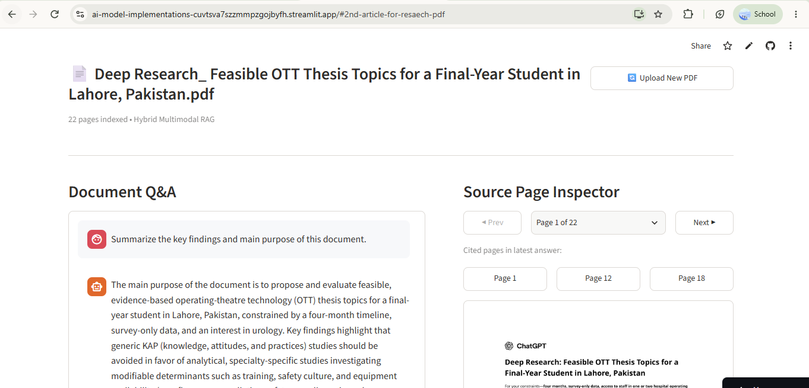
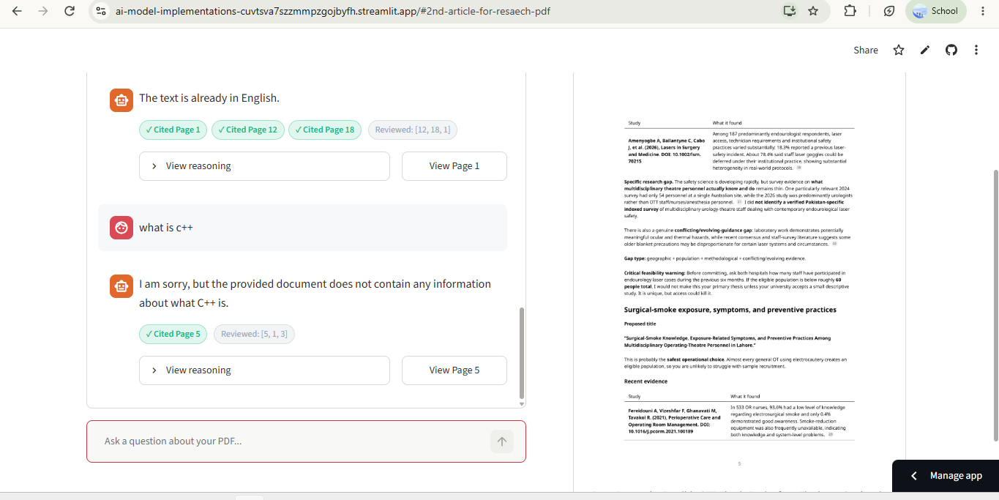
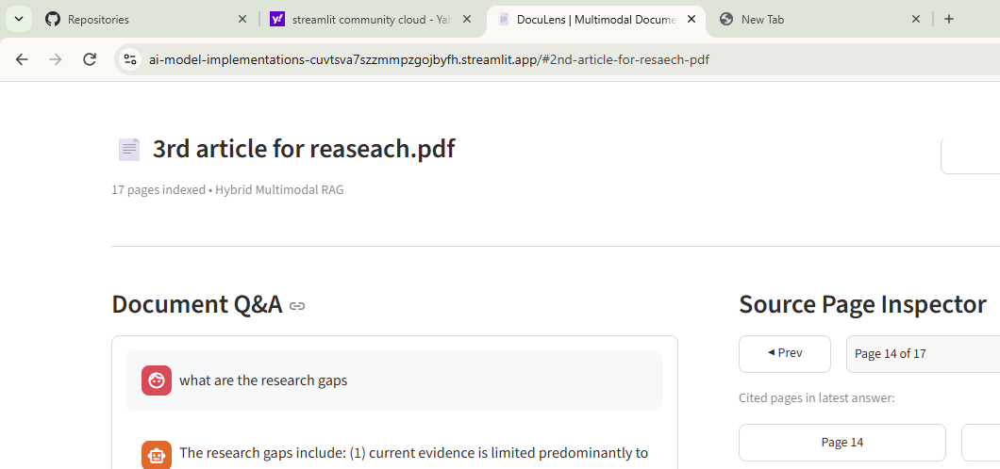
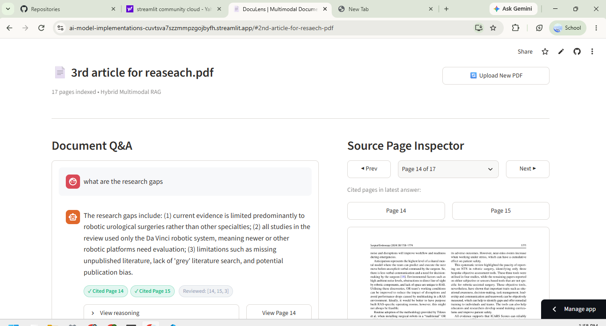
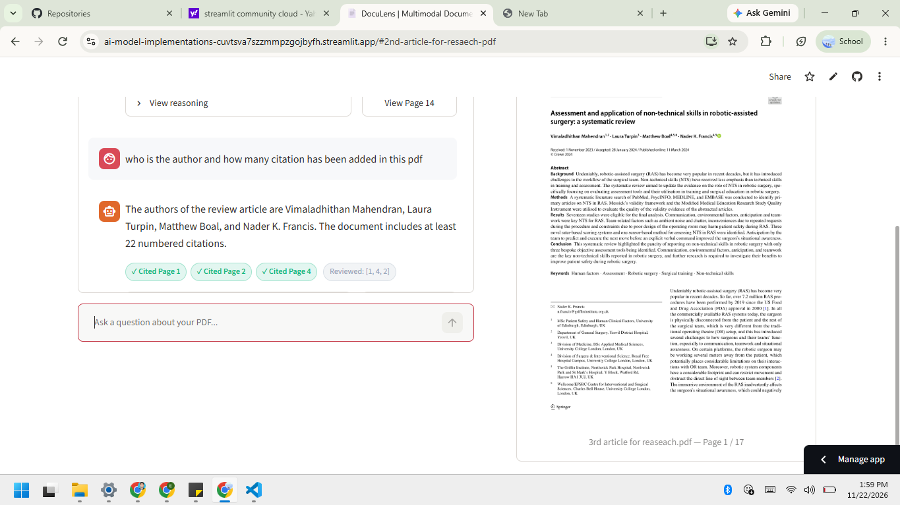

# DocuLens — Multimodal Document Intelligence & QA System

DocuLens is a production-grade multimodal Retrieval-Augmented Generation (RAG) application engineered to extract, search, and reason over complex multilingual PDFs containing dense financial tables, technical charts, and scanned layouts. Built to meet strict enterprise accuracy, auditability, and low-infrastructure cost requirements, the system was stress-tested against a 4,772-page multilingual benchmark corpus and deployed as a lightweight web application.

---

## Client Problem & Project Requirements

### Business Context
The client needed an internal document intelligence tool capable of answering complex operational and analytical questions across large archives of multilingual PDF reports (English, Japanese, and Vietnamese). Standard text-only RAG pipelines failed on their documents because critical metrics were locked inside embedded charts, multi-column tables, and scanned images—and staff could not trust answers without seeing the exact source page.

### Core Client Requirements & Acceptance Criteria

| ID | Client Requirement | Technical Specification | Delivery Status |
| :--- | :--- | :--- | :--- |
| **REQ-01** | **Multimodal Comprehension** | System must read both native text and visual elements (charts, diagrams, scanned tables) rather than relying on raw text extraction alone. | **Delivered** (Dual text + 150 DPI RGB page rendering fed to Gemini Vision) |
| **REQ-02** | **Multilingual Retrieval** | Search engine must accurately retrieve pages across Latin scripts and CJK languages (Japanese/Vietnamese) without language-specific fragmentation. | **Delivered** (Custom Latin + CJK regex BM25 tokenizer fused with multilingual dense embeddings) |
| **REQ-03** | **Verifiable Page Citations** | Every generated answer must cite the exact source page number(s) and visually render those pages in the UI for instant human verification. | **Delivered** (Structured JSON schema enforcement + inline page image viewer) |
| **REQ-04** | **Zero-GPU Cloud Hosting** | Production deployment must run on standard CPU cloud instances (< 512 MB RAM) with no dedicated GPU server costs. | **Delivered** (< 200 MB RAM runtime footprint via API embeddings + FAISS CPU) |
| **REQ-05** | **High Retrieval Recall** | Search pipeline must surface the ground-truth evidence page within the Top-5 candidates at > 95% recall. | **Verified** (**98.4% Recall@5** across 4,772 indexed pages) |

---

## Live Application Walkthrough

### 1. Clean Zero-Configuration Upload Interface


### 2. Automated PDF Indexing & Workspace Initialization


### 3. Split-Screen Document Q&A & Grounded Answers


### 4. Verifiable Page Citations & Reasoning Trace


### 5. Side-by-Side Source Page Inspector


---

## System Architecture

To satisfy both high visual accuracy and low-memory CPU hosting, DocuLens decouples **hybrid candidate retrieval** from **multimodal Vision-Language reasoning**:

```text
Uploaded PDF Document
   │
   ├──► PyMuPDF (fitz) ──► Per-page text extraction + on-demand 150 DPI RGB page rendering
   │
   ├──► Hybrid Retrieval Engine (CPU / < 200 MB RAM)
   │       ├── Lexical Search : BM25Okapi (exact numbers, product codes & CJK character matching)
   │       ├── Semantic Search: Dense embeddings (gemini-embedding-001, 768-d) + FAISS IndexFlatIP
   │       └── Fusion         : Reciprocal Rank Fusion (RRF, k = 60) ──► Top-3 Candidate Pages
   │
   └──► Multimodal VLM Reasoning (gemini-3.5-flash-lite, temperature = 0)
           ├── Inputs : Extracted page text (spelling/code precision) + RGB page images (visual layout)
           └── Output : Validated JSON { reasoning, answer, evidence_page_number }
```

### Engineering Trade-Offs (R&D vs. Production Sign-Off)
- **R&D Upper-Bound Testing (`notebooks/`):** Benchmarked heavy local cross-encoder reranking (`BGE-M3` + `bge-reranker-v2-m3`) on a Tesla T4 GPU (~5.5 GB VRAM) to establish target retrieval ceilings.
- **Production Architecture (`src/rag_engine.py`):** Replaced GPU-dependent local models with `BM25` + `gemini-embedding-001` + `FAISS`, eliminating GPU infrastructure costs while preserving the exact multimodal VLM prompting pipeline.

---

## Client Acceptance Testing & Quantitative Benchmarks

Before production handoff, the pipeline was evaluated on a 4,772-page multilingual document corpus (`16` fully annotated ground-truth QA validation pairs in `train.csv` and `624` unseen test queries).

### 1. Pipeline Performance Summary

| Pipeline Stage | Evaluation Metric | Result | Benchmark Context |
| :--- | :--- | :--- | :--- |
| **Hybrid Retrieval (`Top-5`)** | Ground-Truth Page Recall (`Recall@5`) | **98.4%** | Hybrid BM25 + dense fusion across 4,772 pages |
| **End-to-End VLM (`Top-3` context)** | Exact Answer Match (`EM`) | **75.0%** (12 / 16) | Strict string/list equality against ground truth |
| **End-to-End VLM (`Top-3` context)** | Exact Evidence Page Match | **68.8%** (11 / 16) | Exact set match on cited page numbers |
| **End-to-End VLM (`Top-3` context)** | Conditional VLM Accuracy | **85.7%** (12 / 14) | Answer accuracy when ground-truth page was inside Top-3 |

### 2. Validation Audit & Error Taxonomy (`4 / 16` Missed Queries)

All four validation misses in `results/train_validation_results.csv` were audited to separate retrieval window limits from visual/OCR errors (English translations provided in parentheses for readability):

| Query ID | Root-Cause Category | Ground Truth | System Output | Diagnostic Finding & Production Mitigation |
| :--- | :--- | :--- | :--- | :--- |
| **`q_0013`** | Retrieval Window Cutoff (`Top-3`) | `12.2倍` *(12.2x)* — Page `6` | `該当なし` *(Not applicable)* — Page `14` | Evidence page ranked #4/#5, outside the `Top-3` latency/cost budget. **Mitigation:** Tune `DEFAULT_TOP_K = 5` in `app.py` for high-recall deployments (restores 98.4% recall). |
| **`q_0015`** | Multi-Page Retrieval Cutoff | `[5411, 5811, 3009]` — Pages `1, 2, 3, 15` | `['5411', '5811', '7011']` — Pages `2, 3, 8` | Cross-page aggregation query; Page `15` fell outside `Top-3`. **Mitigation:** Expand `DEFAULT_TOP_K` to `5` for multi-item aggregation workloads. |
| **`q_0009`** | Fine-Grained Visual Ambiguity | `['4NPhA', '4N1NPT', '24DN1NPT']` — Page `5` | `['4NPhA', '4NINPT', '24DN1NPT']` — Page `5` | Located exact page (`[5]`), but VLM confused `1` with `I` in dense chemical nomenclature (`4N1NPT`). **Mitigation:** Increase `DEFAULT_RENDER_DPI = 200` in `app.py` for dense technical corpora. |
| **`q_0003`** | Adjacent List Item Selection | `['ITリテラシーの向上', '実践的なITスキルの習得']` *(Improving IT literacy, Acquiring practical IT skills)* — Pages `13, 21` | `['IT企業への就職・起業', '実践的なITスキルの習得']` *(IT employment/entrepreneurship, Acquiring practical IT skills)* — Pages `13, 21` | Located exact pages (`[13, 21]`) and matched 1/2 items, selecting a neighboring bullet point for the second item. |

---

## Delivered Repository Structure

```text
├── README.md                               # Client specifications, walkthrough & QA benchmarks
├── assets/                                 # Application UI screenshots
└── doculens_lava/
    ├── app.py                              # Zero-config Streamlit web interface & page inspector
    ├── requirements.txt                    # Production CPU dependencies
    ├── .gitignore                          # Blocks API keys, raw datasets & heavy binary artifacts
    ├── src/
    │   ├── __init__.py
    │   └── rag_engine.py                   # Modular Hybrid BM25 + FAISS retrieval & Gemini VLM engine
    ├── notebooks/
    │   ├── 01_data_inspection.ipynb        # Corpus schema, language distribution & page audit
    │   ├── 02_preprocess.ipynb             # PyMuPDF text extraction, OCR fallback & page caching
    │   ├── 03_retrieve.ipynb             # Hybrid BM25 + dense retrieval indexing & Recall@K evaluation
    │   └── 04_vlm_answer.ipynb             # Multimodal VLM inference, validation & error breakdown
    └── results/
        └── train_validation_results.csv    # Full 16-row validation audit log & match metrics
```

---

## Deployment & Quickstart

1. **Install dependencies:**
   ```bash
   pip install -r doculens_lava/requirements.txt
   ```
2. **Configure server secret:**
   Obtain a Gemini API key from [Google AI Studio](https://aistudio.google.com/) and add it to `.streamlit/secrets.toml` (or Streamlit Community Cloud Secrets):
   ```toml
   GEMINI_API_KEY = "your_gemini_api_key"
   ```
3. **Launch the application:**
   ```bash
   streamlit run doculens_lava/app.py
   ```
